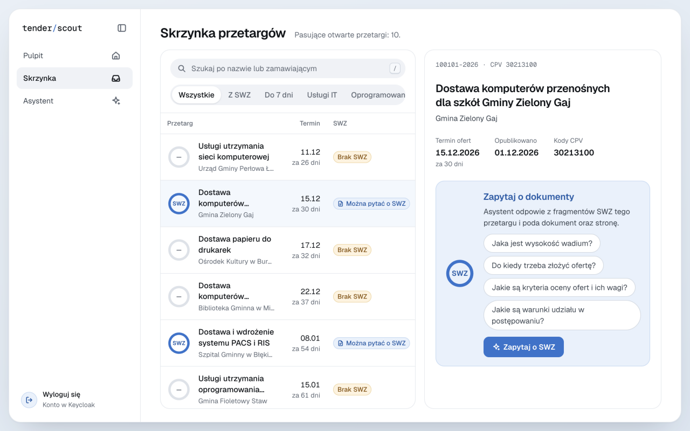
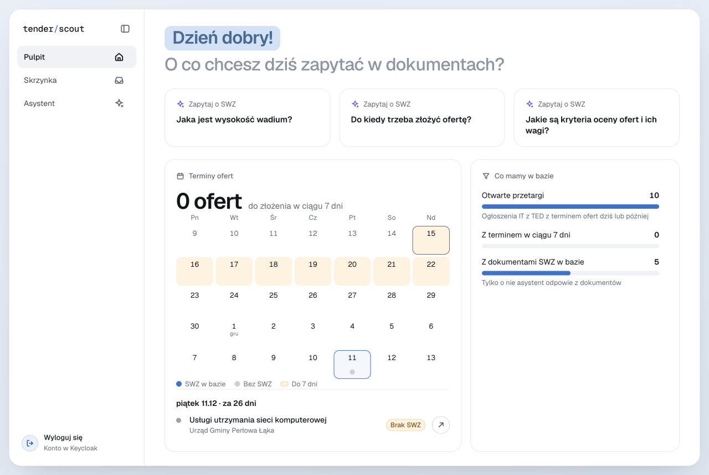
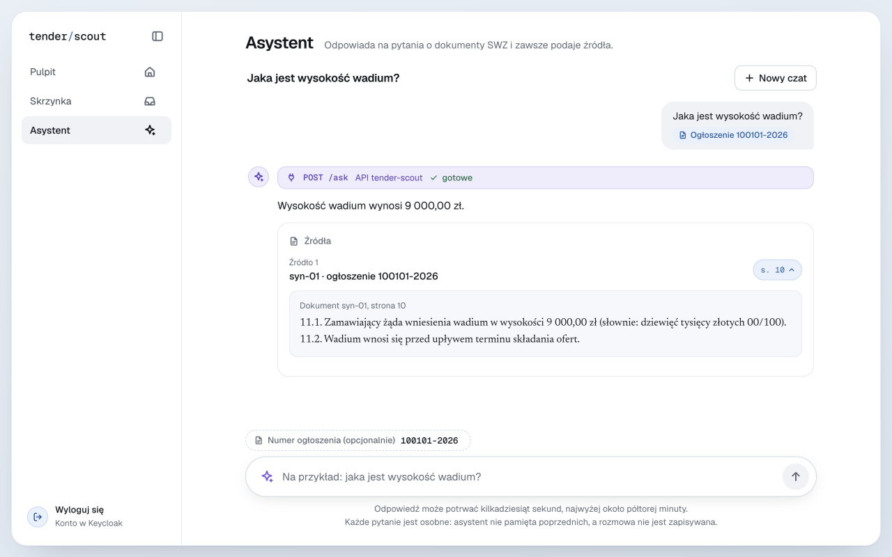
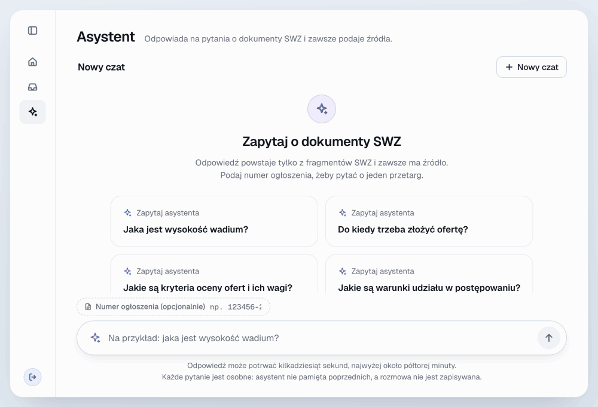
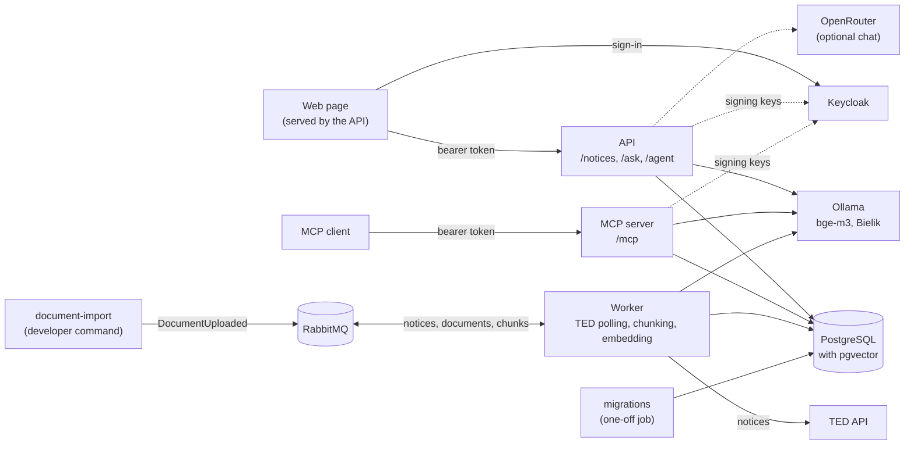

# tender-scout

Tender Scout collects public tenders, stores their documents and answers questions about them with the page and
the passage each answer comes from. It is meant for someone who bids in Polish public tenders and needs to find the
ones that fit and check their conditions without reading every specification. A web page shows the open tenders,
their deadlines and an assistant; an MCP server gives the same data to other agents.

## Showcase

Taken from the compose demo below, on its invented data, signed in as the local test user.









The answer came from Bielik 4.5B v3 (`Q8_0`) on Ollama, the demo's default chat model, in less than 20 seconds. The
GIF is a series of screenshots of that one run and shortens the wait.

## Architecture



The API, the MCP server and the agent share one hybrid search (vectors and full text, fused by rank). The decisions
behind each part are in the [ADRs](docs/adr/README.md).

## Results

All numbers are copied from the [evaluation results](docs/evaluation-results.md), which give the full tables and what
they do not show.

**Search and answers** on a private golden set of 40 questions about 27 real tender specifications, run on
2026-11-10 with `bge-m3`, answers from Bielik 4.5B and Bielik 11B as the judge. The labels were not verified yet (40
auto) and the run used code whose refusal threshold was 0.55, so these are a first measurement.

| Search | All (32) recall@5 | All MRR@10 | Paraphrased (12) recall@5 | Literal (20) recall@5 |
| --- | ---: | ---: | ---: | ---: |
| Vector | 0.50 | 0.32 | 0.42 | 0.55 |
| Full-text | 0.41 | 0.13 | 0.00 | 0.65 |
| Hybrid | 0.53 | 0.28 | 0.00 | 0.85 |

| Answers | Value |
| --- | ---: |
| Citation hit rate | 0.46 of 26 answered |
| Citation precision | 0.33 of 36 citations |
| Faithfulness (judge, 0 invalid replies) | 0.73 of 30 answered |
| Correct refusals | 0.50 of 8 |
| False refusals | 0.19 of 32 |

**Agent tool choices** on 12 invented cases, 3 runs each, scoring the tool calls and not the answers:

| Model | Run | Cases passed | Two-step cases (notice search, then document search) |
| --- | --- | ---: | ---: |
| Bielik 11B v3 `Q4_K_M`, local | 2026-11-14, `2736bf6` | 0.67 (24/36) | 0 of 12 |
| `openai/gpt-4.1-mini` through OpenRouter | 2026-11-14, `f1a0795` | 0.92 (33/36) | 9 of 12 |

The prompts were tuned on the local model, and the cases are few and invented: this is no ranking of the two models
in general.

## Quick start

The whole system runs with Docker Compose on invented data. No .NET SDK is needed, only Docker with Compose v2.

```sh
docker compose up --build
```

Then open <http://localhost:15150>, choose "Zaloguj się" and sign in as `tester` with the password
`local-only-password`, a local-only test user. The page, the inbox and the MCP notice tools work without a model; a
question needs `bge-m3` and a chat model on [Ollama](https://ollama.com/download), see
[Models](docs/running.md#models). Stop with `docker compose down`, and add `--volumes` to start over.

For development the .NET 10 SDK runs the same services from the Aspire AppHost:
`dotnet run --project src/TenderScout.AppHost`.

## Stack

.NET 10, ASP.NET Core, .NET Aspire, EF Core with PostgreSQL and pgvector, RabbitMQ with MassTransit, Keycloak,
Microsoft.Extensions.AI with Ollama or OpenRouter, the MCP C# SDK, OpenTelemetry, PdfPig, xUnit v3 with
Testcontainers, Docker Compose and GitHub Actions.

## Documentation

- [Run the demo](docs/running.md): Compose, the demo data, models, settings, sign-in and troubleshooting
- [Document pipeline](docs/documents.md): import, chunking, embedding and the document search command
- [API and authentication](docs/api-and-auth.md): tokens and scopes, `/ask`, `/notices` and the web page
- [MCP server, agent and hosted chat](docs/agent-and-mcp.md): the tools, `/agent` and OpenRouter
- [Evaluation](evals/README.md) and its [results](docs/evaluation-results.md)
- [Settings](docs/settings.md): every configuration key
- [Traces and metrics](docs/observability.md): OpenTelemetry and the Aspire dashboard
- [Container images](docs/container-images.md): the `Dockerfile` and its check
- [Architecture decisions](docs/adr/README.md)
